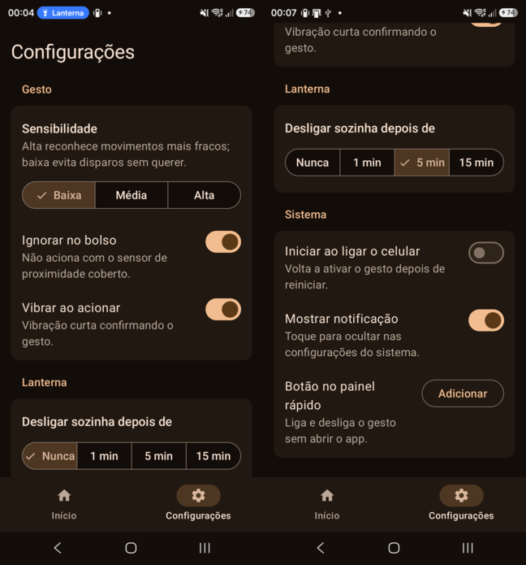
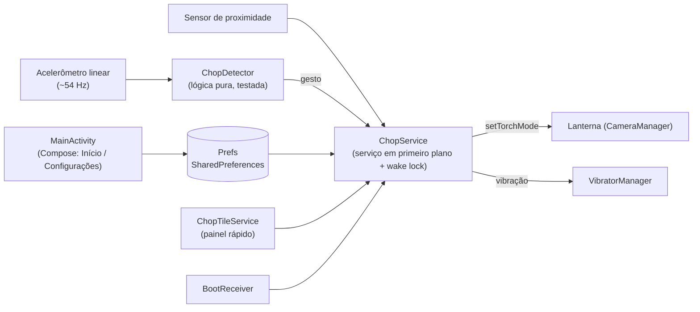

<div align="center">


# Shake2Flashlight

*O gesto "chop-chop" dos Motorola no Android: chacoalhe o celular para ligar ou desligar a lanterna, até com a tela bloqueada.*

</div>

<p align="center">
  
  
  
  
</p>

| | |
| --- | --- |
| **Versão** | 1.2 (`versionCode` 3) |
| **Estado** | Funcional e em uso diário no aparelho de destino; partes das configurações ainda não testadas no aparelho (ver [critérios](#8-critérios-de-aceite)) |
| **Contexto** | Projeto pessoal: recuperar uma função de que eu sentia falta ao trocar de Motorola para Samsung |
| **Alvo** | Qualquer celular com Android 6.0 ou mais novo (testado de verdade num Galaxy S23 Ultra e em emuladores); instalado fora da Play Store |

> **Limite principal:** o gesto foi calibrado com **uma única gravação** de movimento, num único aparelho. Em outro celular, ou com outro jeito de chacoalhar, pode disparar sem querer ou não disparar. Ajuste a sensibilidade nas configurações. O app mantém a CPU acordada enquanto o gesto está ativo, o que tem custo de bateria.

## Sumário

- [Início rápido](#início-rápido)
- [1. Objetivo](#1-objetivo)
- [2. Arquitetura](#2-arquitetura)
- [3. Estrutura do repositório](#3-estrutura-do-repositório)
- [4. Detecção do gesto](#4-detecção-do-gesto)
- [5. Bateria, permissões e privacidade](#5-bateria-permissões-e-privacidade)
- [6. Desenvolvimento e execução local](#6-desenvolvimento-e-execução-local)
- [7. Testes](#7-testes)
- [8. Critérios de aceite](#8-critérios-de-aceite)
- [9. Limites de escopo e evolução](#9-limites-de-escopo-e-evolução)
- [10. Autor e licença](#10-autor-e-licença)

## Início rápido

Para só instalar, baixe o APK da [última release](https://github.com/josemurilors/shake2flashlight/releases/latest) e abra no celular (é preciso permitir a instalação de fontes desconhecidas). Para compilar, com JDK 21, Android SDK e o celular conectado por USB com a depuração ativada:

```bash
./gradlew testDebugUnitTest
./gradlew assembleDebug
adb install -r app/build/outputs/apk/debug/app-debug.apk
```

Abra o **Shake2Flashlight**, ative o interruptor na aba Início e libere a otimização de bateria quando o app pedir.



## 1. Objetivo

O app reconhece uma chacoalhada rápida e forte e alterna a lanterna (acende se estiver apagada, apaga se estiver acesa). O gesto funciona com o app fechado e com a tela bloqueada, porque roda num serviço em primeiro plano.

O app **não** é um app de lanterna completo: não tem estroboscópio nem controle de intensidade, e não usa a câmera, só o flash. Não foi feito para a Play Store: usa um tipo de serviço (`specialUse`) que a loja exige justificar.

### Entregas da versão

- Gesto que liga e desliga a lanterna, também com a tela bloqueada.
- Interface em Material 3 com as cores do papel de parede e tema claro/escuro automático, em duas abas (Início e Configurações).
- Configurações:
  - sensibilidade (baixa, média ou alta);
  - ignorar no bolso (pelo sensor de proximidade);
  - vibrar ao acionar;
  - desligar a lanterna sozinha (nunca, 1, 5 ou 15 min);
  - iniciar ao ligar o celular;
  - mostrar ou ocultar a notificação.
- Botão no painel rápido para ligar e desligar o gesto.
- Ícone adaptável, que também funciona com os ícones temáticos.

### Compatibilidade

O piso é o **Android 6.0 (API 23)**, onde surgiu a API da lanterna (`setTorchMode`). Recursos mais novos têm alternativa nas versões antigas:

| Recurso | Android onde existe | Antes disso |
| --- | --- | --- |
| Sensor de aceleração linear (exige giroscópio) | qualquer aparelho com giroscópio | Acelerômetro comum, com a gravidade descontada por um filtro |
| Canal de notificação e "Mostrar notificação" | 8.0 (API 26) | Notificação simples, sem a opção de ocultar |
| Ícone adaptável | 8.0 (API 26) | Ícone PNG redondo |
| Botão no painel rápido | 7.0 (API 24); botão "Adicionar" no 13 (API 33) | Sem botão (6.0); instrução para adicionar à mão (7 a 12) |
| Tema da janela claro/escuro | 10 (API 29) | Janela sempre clara |
| Cores do papel de parede | 12 (API 31) | Paleta azul e amarela do ícone |
| Permissão de notificação | 13 (API 33) | O aviso leva às configurações do app |
| Tipo de serviço `specialUse` | 14 (API 34) | Serviço em primeiro plano sem tipo |

Aparelhos sem flash, como muitos tablets, mostram um aviso na tela inicial: o gesto é reconhecido, mas não há lanterna para acender.

## 2. Arquitetura



As configurações ficam em `SharedPreferences` (`Prefs.kt`), que são a fonte única da verdade. A interface grava nelas, e o serviço ouve as mudanças e aplica sensibilidade e "ignorar no bolso" na hora, sem reiniciar. O serviço acompanha o estado real da lanterna por `TorchCallback`, então o gesto alterna certo mesmo quando a lanterna foi ligada pelo painel do sistema.

### Stack tecnológica

| Área | Escolha | Papel |
| --- | --- | --- |
| Linguagem | Kotlin 2.2.20 (JVM 17) | Todo o app |
| Interface | Jetpack Compose, BOM 2025.06.00, Material 3 | Telas, cores dinâmicas e tema automático |
| Build | Gradle 8.14.3 (wrapper), AGP 8.13.1 | Compilação e testes |
| Plataforma | Android SDK: `minSdk` 23, `targetSdk`/`compileSdk` 35 | Sensores, câmera, serviço, painel rápido |
| Testes | JUnit 4.13.2 | Testes unitários do detector |

## 3. Estrutura do repositório

```text
shake2flashlight/
├── app/
│   ├── build.gradle.kts
│   └── src/
│       ├── main/
│       │   ├── AndroidManifest.xml
│       │   ├── java/com/shake2flashlight/
│       │   │   ├── MainActivity.kt      # interface Compose (abas Início e Configurações)
│       │   │   ├── ChopService.kt       # serviço: sensores, lanterna, vibração, desligar sozinha
│       │   │   ├── ChopDetector.kt      # algoritmo do gesto (sem dependência de Android)
│       │   │   ├── Prefs.kt             # chaves e padrões das configurações
│       │   │   ├── ChopTileService.kt   # botão do painel rápido
│       │   │   └── BootReceiver.kt      # inicia o serviço após reiniciar
│       │   └── res/                     # ícone adaptável, ícone do painel, tema da janela
│       └── test/
│           ├── java/.../ChopDetectorTest.kt
│           └── resources/chop_recording.csv   # gravação real do gesto no S23 Ultra
├── icons/
│   ├── chop-lanterna-1..3/   # conjuntos de ícone exportados (o 3 é o usado)
│   └── icon-work/            # SVGs editáveis e folhas de revisão
├── docs/img/                 # capturas de tela do README
├── build.gradle.kts · settings.gradle.kts · gradle.properties
└── gradlew · gradlew.bat · gradle/wrapper/
```

## 4. Detecção do gesto

A gravação real mostrou que o gesto é uma oscilação rápida num eixo: cerca de ±80 m/s², com a direção invertendo a cada ~75 ms, sem a força cair perto de zero entre as machadadas. Por isso o `ChopDetector` conta **inversões fortes de direção** em cada eixo da aceleração linear, e não picos isolados de força:

- uma inversão conta quando o valor no eixo passa do limite com o sinal oposto ao da última;
- inversões com mais de 250 ms de distância recomeçam a contagem;
- ao atingir o número exigido, o detector dispara e ignora o resto do mesmo movimento até o celular ficar 400 ms parado.

| Sensibilidade | Limite (m/s²) | Inversões |
| --- | --- | --- |
| Baixa | 40 | 5 |
| Média (padrão) | 30 | 4 |
| Alta | 20 | 4 |

**Limitações:** os valores vêm de uma gravação só. Não há medição de quantas vezes o gesto dispara sem querer andando ou correndo, nem de como se comporta uma machadada simples.

## 5. Bateria, permissões e privacidade

- **Tela bloqueada:** o serviço segura um `PARTIAL_WAKE_LOCK` enquanto o gesto está ativo. Sem ele, o Android para de entregar os dados do sensor quando a CPU dorme. Isso tem custo de bateria, que ainda não foi medido.
- **Otimização de bateria:** vários fabricantes (Samsung, Xiaomi, Huawei e outros) encerram serviços em segundo plano. A aba Início avisa e leva à tela que libera o app.
- **Notificação:** o Android exige uma notificação para serviços em primeiro plano. A opção "Mostrar notificação" abre a categoria "Gesto chop-chop" nas configurações do sistema, onde ela pode ser ocultada sem parar o gesto.
- **Permissões:**
  - `FOREGROUND_SERVICE` e `FOREGROUND_SERVICE_SPECIAL_USE`: rodar o gesto em primeiro plano;
  - `POST_NOTIFICATIONS`: mostrar a notificação do serviço;
  - `WAKE_LOCK`: manter a CPU acordada com a tela apagada;
  - `REQUEST_IGNORE_BATTERY_OPTIMIZATIONS`: pedir a liberação da otimização de bateria;
  - `VIBRATE`: vibrar ao acionar;
  - `RECEIVE_BOOT_COMPLETED`: iniciar ao ligar o celular.

  O app **não** pede a permissão de câmera (a lanterna não precisa dela) nem a de internet.
- **Privacidade:** nenhum dado sai do aparelho. A gravação de sensor em `app/src/test/resources` é só movimento, sem dados pessoais.

## 6. Desenvolvimento e execução local

### Pré-requisitos

- **JDK 21** para rodar o Gradle. O JDK que vem com o Android Studio atual (o JBR 25) **não** funciona com o Gradle 8.14.3 deste projeto.
- Android SDK com a plataforma 35.
- Celular com Android 6.0 ou mais novo e a depuração USB ativada (Opções do desenvolvedor), ou um emulador do Android Studio.

### Passo a passo

1. Abra a pasta no Android Studio, que cria o `local.properties` com o `sdk.dir`. Pela linha de comando, crie o arquivo com `sdk.dir=<caminho do SDK>`.
2. Rode `./gradlew assembleDebug` (no Windows, `gradlew.bat assembleDebug`) com `JAVA_HOME` apontando para um JDK 21.
3. Instale com `adb install -r app/build/outputs/apk/debug/app-debug.apk` ou pelo botão Run do Android Studio. A depuração por Wi-Fi também funciona (`adb pair` e depois `adb connect`).
4. Para ver o detector agindo, filtre o log pela tag `CHOP`. Cada disparo registra o estado da lanterna e do sensor de proximidade:

```bash
adb logcat -s CHOP:D
```

Não há variáveis de ambiente nem segredos, então o projeto não precisa de `.env`.

## 7. Testes

```bash
./gradlew testDebugUnitTest
```

São 8 testes unitários do `ChopDetector`:

- ondas sintéticas: chacoalhada forte dispara uma vez; balanço lento, chacoalhada fraca e balanço único não disparam;
- os três níveis de sensibilidade;
- dois gestos separados por uma pausa disparam duas vezes;
- **a gravação real do aparelho**, que dispara uma vez por rajada (6 vezes).

Serviço, interface e sensores foram testados à mão no S23 Ultra e em emuladores do Android Studio (Android 6.0, 8.0 e 17), sem testes automatizados. No emulador, a chacoalhada é simulada injetando valores no acelerômetro:

```bash
adb -e emu sensor set acceleration 45:9.8:0
adb -e emu sensor set acceleration -45:9.8:0
```

Alterne os dois comandos algumas vezes. Os emuladores antigos (API 23 e 26) leem o sensor só a cada ~200 ms, então é preciso esperar uns 190 ms entre os comandos e repetir por mais tempo. Num celular de verdade, que lê a ~50 Hz, isso não acontece.

## 8. Critérios de aceite

- [x] O gesto acende e apaga a lanterna com a tela ligada.
- [x] O gesto funciona com a tela bloqueada.
- [x] O gesto alterna certo depois que a lanterna é mudada pelo painel do sistema.
- [x] Os testes unitários passam, incluindo a gravação real.
- [x] As configurações ficam salvas, e sensibilidade e "ignorar no bolso" valem na hora.
- [x] O serviço volta sozinho ao abrir o app depois de uma atualização.
- [x] "Mostrar notificação" abre a tela da categoria certa no sistema.
- [x] O tema escuro com as cores do papel de parede foi conferido no aparelho.
- [x] Funciona no emulador com Android 6.0 (API 23), sem giroscópio: o gesto dispara pelo acelerômetro comum.
- [x] Funciona no emulador com Android 8.0 (API 26): notificação no canal novo e opção "Mostrar notificação".
- [x] Funciona no emulador com Android 17 (API 37): o gesto acende e apaga o flash simulado.
- [x] O tema claro com a paleta do ícone (Android anterior ao 12) foi conferido no emulador.
- [ ] Tema claro com as cores do papel de parede (Android 12+) conferido: falta testar num aparelho no modo claro.
- [ ] "Iniciar ao ligar o celular" conferido: falta reiniciar o aparelho e testar.
- [ ] "Desligar sozinha" conferido: falta esperar o tempo e ver a lanterna apagar.
- [ ] Botão do painel rápido conferido: falta adicionar e testar.
- [ ] "Ignorar no bolso" conferido: depende do sensor de proximidade de cada aparelho, falta testar no bolso.
- [ ] Taxa de disparos sem querer medida (andando, correndo, no bolso): sem medição.
- [ ] Consumo de bateria medido: sem medição.

## 9. Limites de escopo e evolução

**Dentro:** gesto, lanterna, configurações do gesto, serviço em primeiro plano, painel rápido, início no boot.

**Fora:** publicação na Play Store, Android anterior ao 6.0 (não tem a API de lanterna), controle de intensidade, estroboscópio, testes instrumentados.

**Evoluções possíveis:** calibração guiada no próprio app (gravar o gesto do usuário e ajustar os limites); detecção em lote no sensor hub para gastar menos bateria; testes de interface com Compose.

## 10. Autor e licença

| Nome | Papel | GitHub |
| --- | --- | --- |
| José Murilo R. Sabalo | Autor | [@josemurilors](https://github.com/josemurilors) |

Licença: [MIT](LICENSE).
